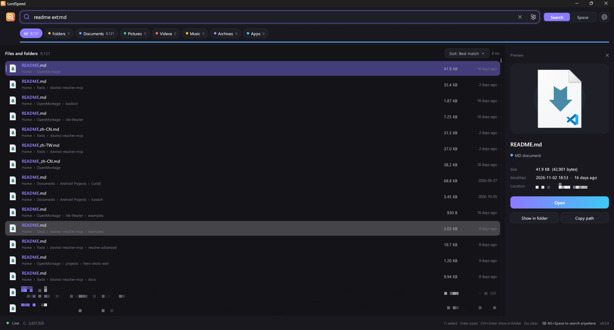
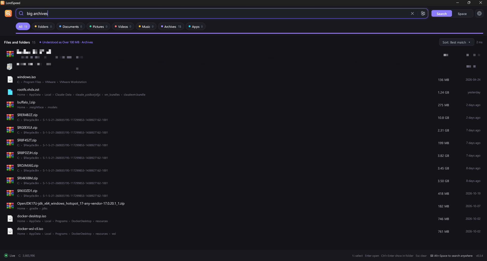
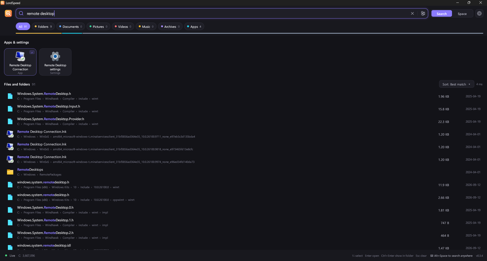
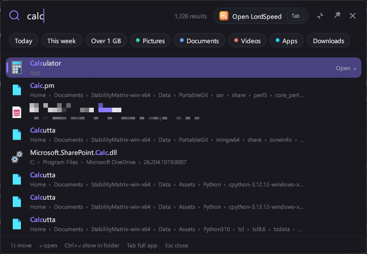
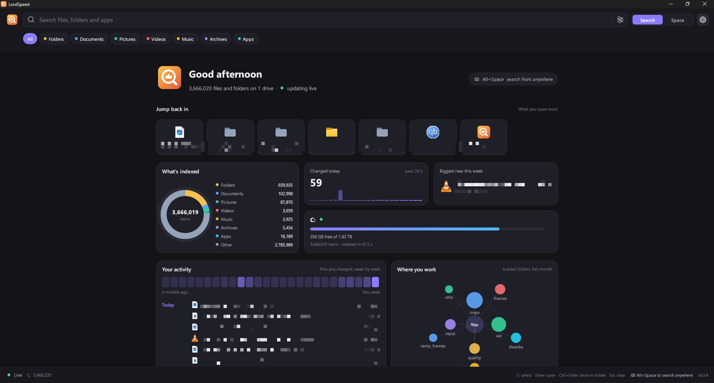
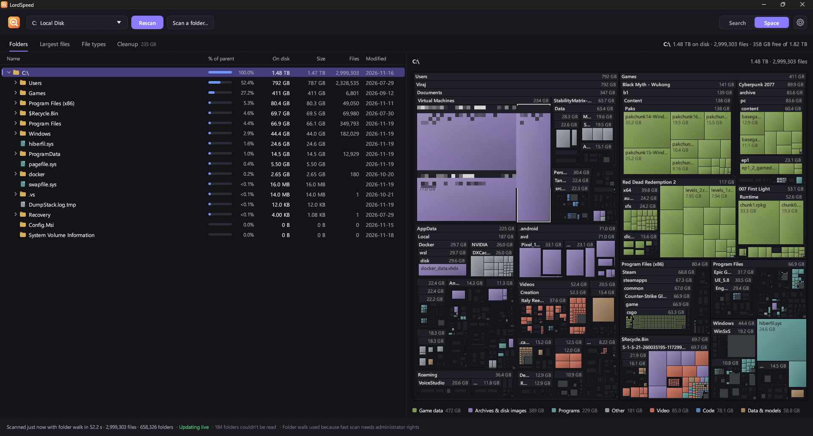
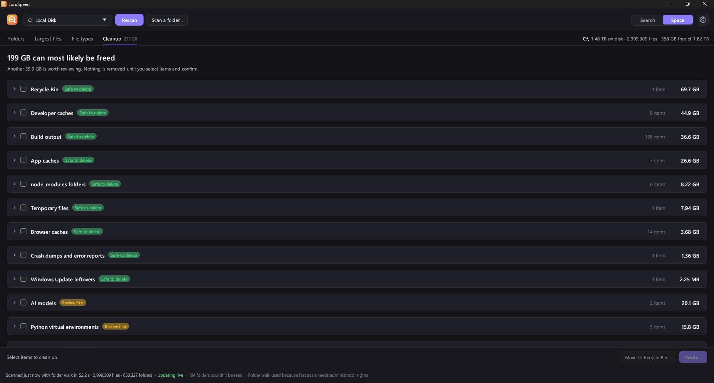
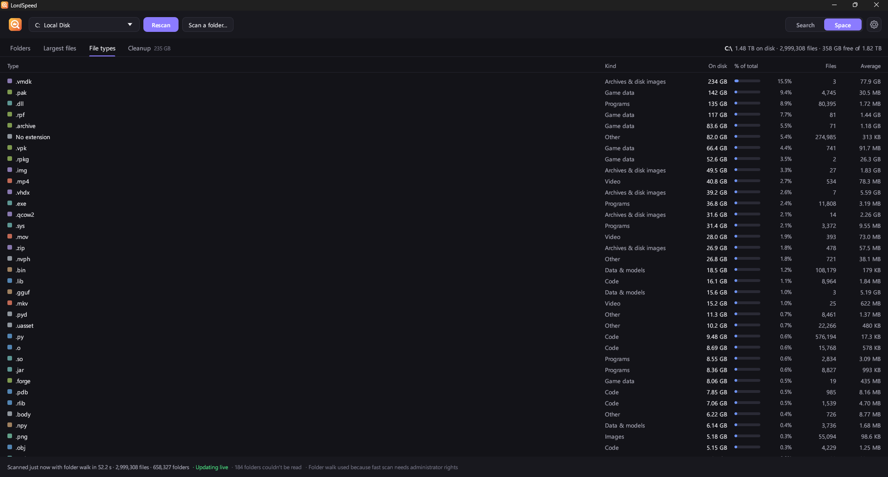
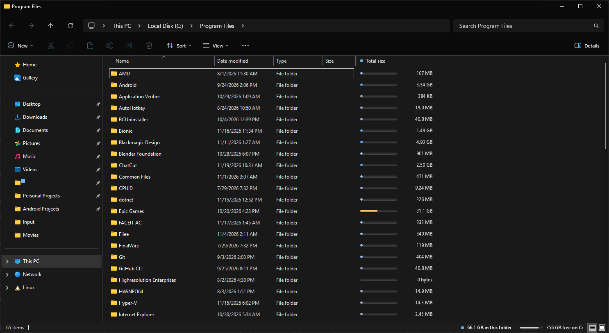
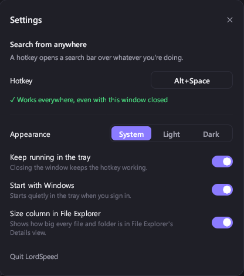

# Godspeed

**Instant file search and disk space analyzer for Windows.**

Type a few letters and get every matching file, folder and app on your PC in milliseconds.
See where your disk space went, clean it up, and get folder sizes right inside File Explorer.

[**Download the latest release**](https://github.com/TheRedViperV/godspeed-releases/releases/latest) · Windows 10/11 · v0.3.4

---

## Two editions, one app

Godspeed and LordSpeed are built from the same code and get the same updates. The only difference is how they read your drives.

| | **Godspeed** | **LordSpeed** |
|---|---|---|
| How it indexes | Reads the NTFS Master File Table directly | Walks folders in parallel through the regular file APIs |
| Live updates | NTFS change journal (USN) | Windows folder-change notifications |
| Admin rights | Required | **Never needed** |
| Speed | Fastest | Slower first index, then just as fast to search |
| Good for | Your own PC | Work and client PCs where you can't get admin |

Both open from their saved index straight away, so a search works the moment the window appears.

---

## Features

### ⚡ Instant search

- **Millions of names in milliseconds.** The index is kept in compact arrays and every search sweeps all of it in parallel. The timing shows next to the results (usually single-digit ms).
- **Stays current by itself.** Creates, renames and deletes show up as they happen. No rescans and no "index out of date".
- **Type filters with live counts:** All, Folders, Documents, Pictures, Videos, Music, Archives and Apps. Each one shows how many matches it has as you type.
- **Date filters:** past 24 hours, week, month or year, or over a year ago. Results can be sorted.
- **Forgives typos.** When nothing matches exactly, a second pass allows for wrong, missing or swapped letters.
- **Learns what you open.** Things you use often and recently rank higher ("frecency"), and so does whatever you picked for the same search last time.
- **Groups look-alike results** (thousands of copies of the same system file, for example) so your own files stay on top.
- **Real Windows icons and thumbnails**, the same ones File Explorer shows.
- **Preview pane** with size, dates and location, plus **Open**, **Show in folder** and **Copy path**. Right-click any result for *Copy full path* and *Copy name*.

#### Search syntax

| Query | What it does |
|---|---|
| `tax 2025` | Every word must appear in the name |
| `*.psd` · `img_????.jpg` | `*` and `?` match the whole name |
| `ext:jpg;png` | Only these extensions |
| `size:>1gb` · `size:<10mb` | Filter by size |
| `file:` · `folder:` | Only files, or only folders |
| `projects\notes` | A word containing `\` matches against the full path |
| `report !draft` | `!word` leaves matches out |
| `"exact phrase"` | Quotes keep spaces together |

#### Plain-language search

Search for what you mean, like `photos from last week`, `big videos` or `pdf invoices this month`. Godspeed picks out words such as *today*, *yesterday*, *last week/month/year*, *photos*, *videos*, *music*, *documents*, *archives*, *pdf*, *big* and *small*, turns them into filters, and tells you how it read your search.

### 🚀 Apps, settings and admin tools

Installed apps (classic programs and Store apps), Settings pages and Windows admin tools come up above your files. That means `remote desktop`, `wallpaper` or `group policy` find the real thing, not just files with those words in their names.

### ⌨️ Search from anywhere

Press **Alt+Space** (you can change it) from any app and a floating search bar opens over whatever you're doing, even while the main window is closed.

- One-click filters: **Today**, **This week**, **Over 1 GB**, **Pictures**, **Documents**, **Videos**, **Apps**, **Downloads**
- Drag it anywhere and it opens there next time. Fold it down to just the search line, or pin it so it stays open when you click elsewhere.
- Press **Tab** to carry your search over to the full app.

### 🏠 Home screen

When the search box is empty, the home screen shows:

- **Jump back in:** what you open most
- **What's indexed:** a breakdown of every file on your drives by type
- **Changed today** and **Biggest new this week**
- **Drive usage** for each indexed drive
- **Your activity:** the files you changed, week by week
- **Where you work:** a map of your busiest folders this month

### 📊 Space: where your disk space went

Switch to **Space** (Ctrl+2) to scan a whole drive or a single folder. Godspeed reads the MFT, and LordSpeed walks the folders in parallel (about 3 million files in under a minute, without admin rights).

- **Folders:** an expandable size table next to a **squarified treemap**, colour-coded by kind (game data, archives and disk images, programs, video, code, data and models)
- **Largest files** across the whole scan
- **File types:** space by extension, with file count and average size
- **Cleanup:** space you can usually get back, sorted into *Safe to delete* and *Review first*
- **Stays live:** the scan follows changes on disk while the app is open
- **Reopens instantly:** your last scan of each drive or folder is saved (LZ4-compressed), so it's there the next time you open the app

#### Cleanup

Nothing is removed until you select items and confirm. You can **Move to Recycle Bin** or **Delete** permanently. It finds:

| Category | Examples |
|---|---|
| Recycle Bin | Everything already in it |
| Temporary files | Your temp folder, the Windows temp folder |
| Browser caches | Chrome, Edge, Brave, Vivaldi, Opera, Firefox |
| App caches | Discord, Slack, Spotify, DirectX shader cache, internet cache |
| Developer caches | npm, pnpm, Yarn, Bun, NuGet, Gradle, Maven, Cargo, Go, Conda, Composer, Electron |
| Build output | Rust `target/`, `__pycache__`, `.pytest_cache`, `.mypy_cache` and more, found next to their projects |
| `node_modules` folders | Inside your projects (not the ones apps ship with) |
| Crash dumps and error reports | App crash dumps, Windows Error Reporting, minidumps |
| Windows Update leftovers | Downloaded updates, Delivery Optimization cache |
| AI models *(review first)* | Hugging Face, Ollama, LM Studio |
| Python virtual environments *(review first)* | `venv` / `.venv` folders |
| Old downloads *(review first)* | Installers, archives and disk images in Downloads that haven't changed in 30 days |
| Virtual disks *(info only)* | VM, Docker and WSL disks, with advice on shrinking them safely |

<table>
<tr>
<td></td>
<td></td>
</tr>
</table>

### 📁 Folder sizes in File Explorer

Explorer has never shown how big a folder is. Godspeed adds a **Total size** column to Details view, lined up with each row, with a bar showing how big each item is compared to the others.

- The **folder's total** and free space appear in Explorer's status bar
- **Hover** over a size for a card with more detail, including what changed recently
- **Click the column header** to see the folder's items biggest first
- **Right-click** a size for *Copy size*, *Open in Space*, *Show biggest files*, *Show as share of folder* and *Highlight growth* (today or this week)
- In **Tiles** view, sizes appear under the folder names
- Sizes come from the search index, so they show up immediately. Network shares and other unindexed places are read in the background, and their sizes fill in as they're worked out.
- Follows whichever Explorer window you're using. Clicks still go through to Explorer as normal.

### ⚙️ Fits into Windows

- **Lives in the tray.** Closing the window keeps the hotkey working. It can also **start with Windows**, quietly in the tray.
- **One copy at a time.** Opening it again brings up the copy that's already running.
- **Appearance:** System, Light or Dark
- **One-click updates.** It checks GitHub a few seconds after launch and then once a day. Updates are checked against their published SHA-256 before the app swaps itself out and restarts.
- **Sharp everywhere.** The UI is drawn with wgpu on DirectX, so there's no flicker, with OpenGL as a fallback. The icons are drawn in code, so they look sharp at any size.

---

## Keyboard shortcuts

| Keys | Action |
|---|---|
| **Alt+Space** | Open the floating search bar from anywhere (can be changed in Settings) |
| **↑ / ↓**, **PgUp / PgDn** | Move through results |
| **Enter** | Open |
| **Ctrl+Enter** | Show in folder |
| **Ctrl+Shift+C** | Copy the selected item's path |
| **Ctrl+F** / **Ctrl+L** | Jump to the search box |
| **Ctrl+1** / **Ctrl+2** | Switch between Search and Space |
| **Tab** *(floating bar)* | Open the search in the full app |
| **Esc** | Clear the selection, then the search (closes the floating bar) |

---

## Install

1. Download `godspeed.exe` or `lordspeed.exe` from the [latest release](https://github.com/TheRedViperV/godspeed-releases/releases/latest).
2. Run it. There's no installer. Godspeed asks for admin rights so it can read the file table, and LordSpeed doesn't.
3. Press **Alt+Space** and start typing.

Settings, history and saved scans are kept in `%LOCALAPPDATA%\Godspeed` (or `%LOCALAPPDATA%\LordSpeed`).

